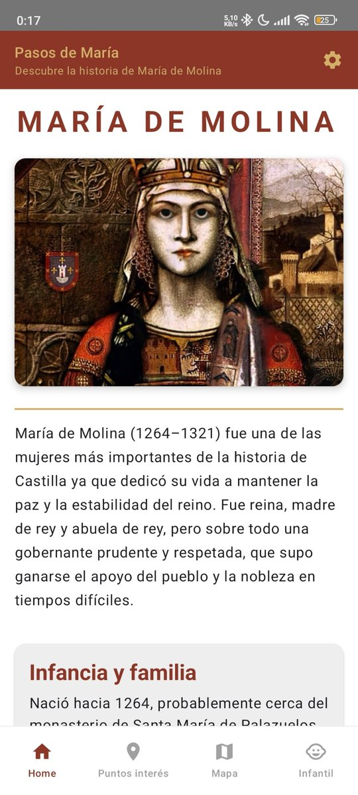
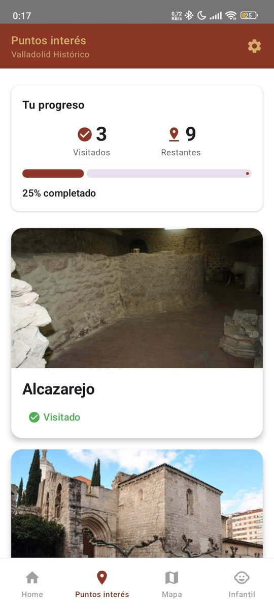
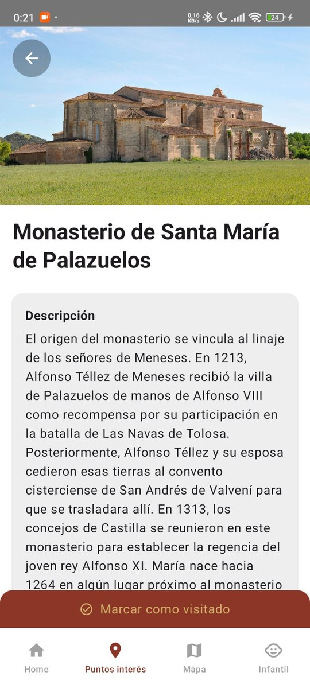
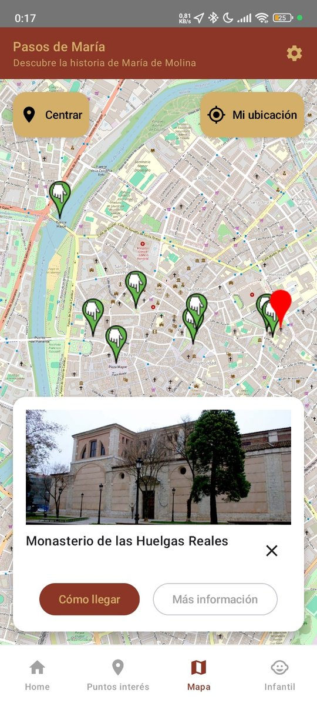
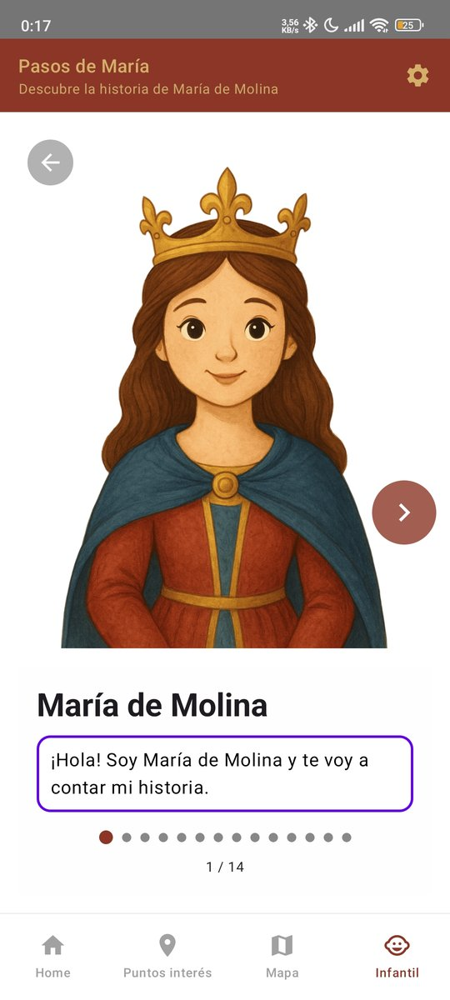
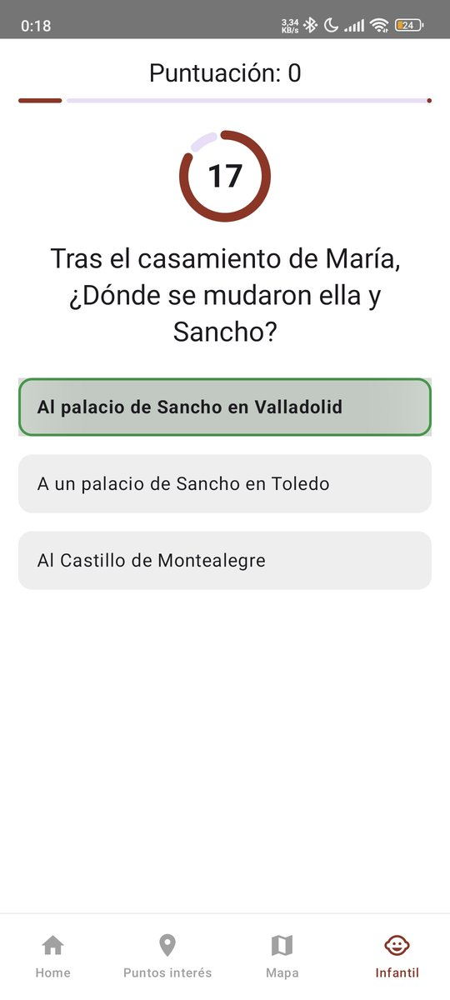

# Pasos de María

Aplicación educativa para Android sobre la figura histórica de María de Molina y los lugares de Valladolid relacionados con ella. Está **publicada en [Google Play](https://play.google.com/store/apps/details?id=com.edunova.mariamolina)** y obtuvo el **tercer premio en el concurso OnAppExperience**.

<p align="center">
  <a href="https://play.google.com/store/apps/details?id=com.edunova.mariamolina"><b>Descargar en Google Play</b></a>
</p>

## Capturas

<p align="center">
  
  
  
</p>
<p align="center">
  
  
  
</p>

## Características

- 🗺️ **Mapa interactivo** con puntos de interés históricos
- 📍 **Navegación GPS** hacia los lugares de María de Molina
- 🏛️ **Fotos panorámicas 360°** de los monumentos
- 🎮 **Quiz educativo** en modo solitario y **multijugador en tiempo real** entre varios dispositivos
- 👥 **Modo profesor** para crear partidas en clase
- 🧒 **Modo infantil** con la historia narrada por la propia María de Molina
- 🌓 **Tema claro/oscuro** adaptativo
- 📱 **Soporte para tablets** y diferentes orientaciones
- 🌍 Traducida por completo al **español, inglés, francés y alemán**

## Tecnologías

- **Kotlin** + **Jetpack Compose** (Material 3), arquitectura MVVM con ViewModels y repositorios
- **Firebase**: Auth, Firestore (con listeners en tiempo real para las partidas multijugador) y Crashlytics
- **Hilt** para inyección de dependencias
- **OpenStreetMap** para los mapas

## Equipo

Proyecto desarrollado en equipo para la asignatura Sistemas Móviles del Grado en Ingeniería Informática (Universidad de Valladolid). Gonzalo Colina es el autor de unos dos tercios de los commits del repositorio.

## Instalación

Puedes descargar la aplicación desde [Google Play](https://play.google.com/store/apps/details?id=com.edunova.mariamolina).

Para compilarla desde el código:

1. Clona el repositorio:
   ```bash
   git clone https://github.com/gonzalocolina/app-maria-molina.git
   ```

2. Abre el proyecto en Android Studio

3. Sincroniza Gradle y ejecuta la app

## Política de Privacidad

📜 **[Ver Política de Privacidad](https://gonzalocolina.github.io/mariamolina/)**

La política de privacidad está disponible en línea y cumple con los requisitos de Google Play Store.

## Estructura del Proyecto

```
app/src/main/java/es/uva/inf/mariamolina/
├── data/
│   ├── local/          # Sesión de partida activa
│   ├── model/          # Modelos de datos
│   ├── repository/     # Repositorios (incluido el multijugador en tiempo real)
│   └── service/        # Servicio de traducción
├── di/                 # Módulos de Hilt
├── domain/
│   └── scoring/        # Lógica de puntuación del quiz
├── ui/
│   ├── navigation/     # Navegación
│   ├── screens/        # Pantallas
│   ├── theme/          # Tema Material 3
│   └── viewmodel/      # ViewModels
└── MariaMolinaApplication.kt
```

## Licencia

© 2025 Universidad de Valladolid

## Contacto

- **Email:** mariamolina.app@gmail.com
- **Institución:** Universidad de Valladolid
